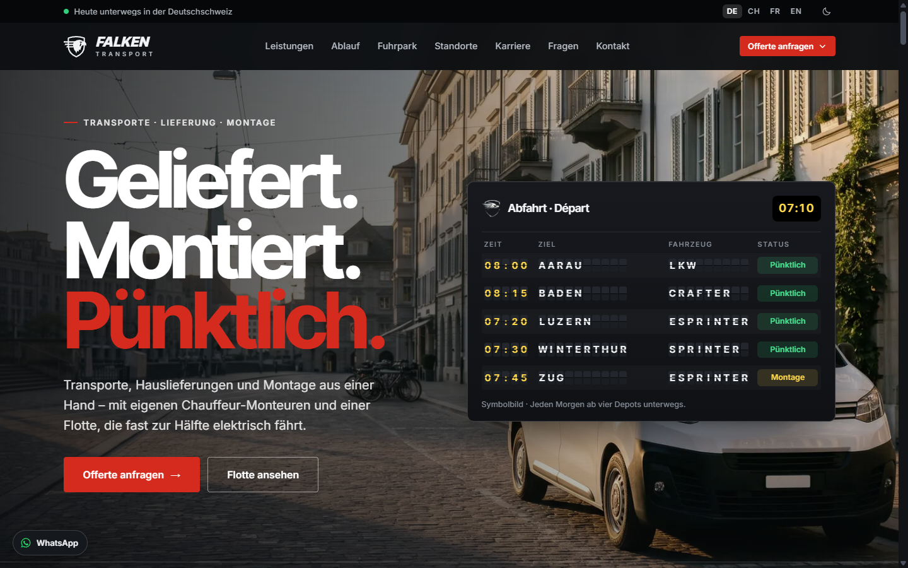
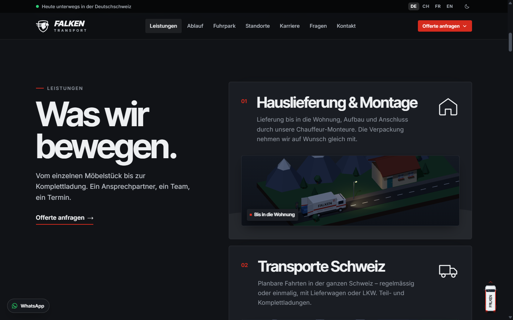
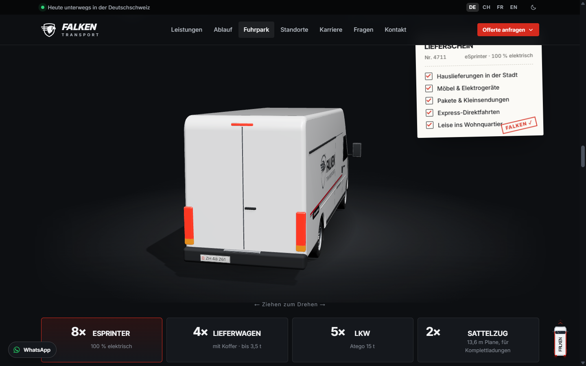
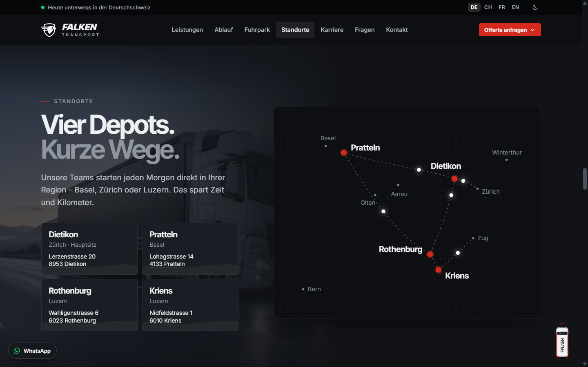
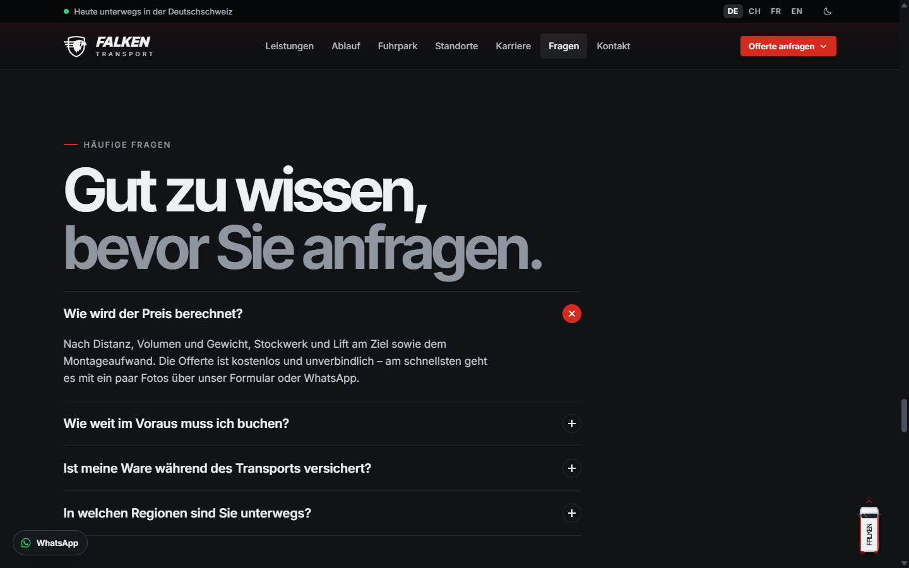
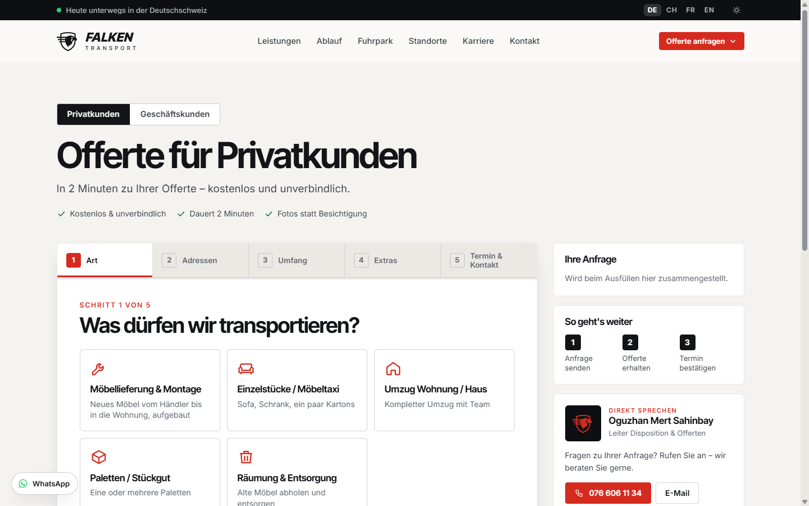
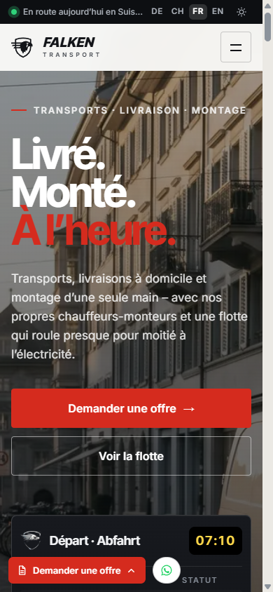

<div align="center">

# Falken Transport – Website

**Transporte · Lieferung · Montage in der Schweiz**

[falkentransport.ch](https://falkentransport.ch) · Deutsch · Schwiizerdüütsch · Français · English

</div>



Die neue Website der **Falken Transport GmbH**: modern, schnell und in vier Sprachen. Kundinnen und Kunden sehen auf einen Blick, was Falken macht, mit welchen Fahrzeugen und von welchen Depots aus – und können in zwei Minuten eine Offerte anfragen.

---

## Inhalt

- [Screenshots](#screenshots)
- [Was die Website kann](#was-die-website-kann)
- [Offerte anfragen](#offerte-anfragen)
- [Sprachen, Design und Datenschutz](#sprachen-design-und-datenschutz)
- [Technik](#technik)
- [Lokal ansehen](#lokal-ansehen)

---

## Screenshots

| Leistungen mit kleinen 3D-Filmen | Fuhrpark in 3D zum Drehen |
|:---:|:---:|
|  |  |
| **Vier Depots mit Karte** | **Häufige Fragen** |
|  |  |

| Offerte in 5 Schritten (Tagmodus) | Auf dem Handy (Französisch) |
|:---:|:---:|
|  |  |

---

## Was die Website kann

**Startseite «Die Route»**
- Grosser Einstieg «Geliefert. Montiert. Pünktlich.» mit einer **Abfahrtstafel** wie am Bahnhof (Klappanzeige mit Zielen und Status)
- **«Heute unterwegs in der Deutschschweiz»**: kleine Live-Anzeige, wie viele Chauffeure und Monteure gerade unterwegs sind (anonym, ohne Namen)
- Zahlen, Versicherung (Allianz Transportversicherung) und ein Bildband «Die ganze Schweiz»

**Leistungen**
- Vier Leistungskarten (Hauslieferung & Montage, Transporte Schweiz, Express & Direktfahrten, Spezial & International) – jede mit einem **kleinen 3D-Film**
- Beim Darüberfahren über «Offerte anfragen» fächern sich drei Wege auf: Privatkunden, Geschäftskunden, Schnell-Offerte

**Ablauf «Ihre Route»**
- Anfrage → Offerte → Planung → Geliefert & montiert, mit einer Routenlinie, die sich beim Scrollen füllt

**Fuhrpark**
- **17 Fahrzeuge, 8 davon elektrisch** – Ziel: 25 Elektrofahrzeuge bis 2030
- **3D-Showroom**: eSprinter, Lieferwagen mit Koffer, LKW Atego und Sattelzug im Falken-Design, mit der Maus oder dem Finger drehbar
- Zu jedem Fahrzeug ein **«Lieferschein»**, was damit transportiert wird

**Standorte**
- **Vier Depots** – Dietikon (Hauptsitz), Pratteln, Rothenburg und Kriens – mit Adressen und einer animierten Karte der Wege dazwischen

**Weitere Bereiche**
- Warum Falken · Ein Tag bei Falken · **Karriere** · Partner (3D-Logo-Karussell)
- **Häufige Fragen**: 15 Fragen und Antworten in allen Sprachen (für Google als FAQ markiert)
- **WhatsApp-Knopf** für schnelle Fragen und ein kleiner **Falken-Lieferwagen**, der auf Klick wieder nach oben fährt
- Impressum und Datenschutzerklärung

---

## Offerte anfragen

- Eigene Offerte-Seite für **Privatkunden** und **Geschäftskunden**, Schritt für Schritt in 5 Schritten (Art, Adressen, Umfang, Extras, Termin & Kontakt)
- Zusätzlich eine kurze **Schnell-Offerte** direkt auf der Startseite
- **Fotos und Dateien hochladen** statt Besichtigung (Bilder werden vor dem Senden automatisch verkleinert)
- Die Anfrage kommt direkt per **E-Mail** bei Falken an; die Kundin oder der Kunde erhält sofort eine **Bestätigung in der eigenen Sprache** mit Referenznummer
- Seitliche Zusammenfassung «Ihre Anfrage» und direkter Kontakt zur Disposition

---

## Sprachen, Design und Datenschutz

- **4 Sprachen**: Deutsch, Schwiizerdüütsch, Français, English – umschaltbar oben rechts
- **Tag- und Nachtmodus** (Sonne/Mond-Symbol)
- Läuft auf **Handy, Tablet und Computer** – getestet auf 8 Bildschirmgrössen ohne Fehler
- **Keine Cookies, kein Tracking**, Schriften lokal gespeichert, Hosting in der **Schweiz**
- Ein einziger 3D-Motor für alle 3D-Szenen – flüssig auch auf dem Handy; Szenen rechnen nur, wenn sie sichtbar sind

---

## Technik

| Bereich | Umsetzung |
|---|---|
| Seiten | Statisches HTML, CSS und JavaScript – kein Build-Schritt nötig |
| 3D | [Three.js](https://threejs.org) (lokal eingebunden), ein gemeinsamer Renderer für alle Szenen |
| Kleine Animationen | WebAssembly (z. B. der «Nach oben»-Lieferwagen) |
| Sprachen | Eigene Übersetzungsdatei (`assets/js/i18n.js`) |
| Design | Farbschema in `assets/css/themes/` (Grafit + Schweizer Rot, Tag/Nacht) |
| Offerte | Formular mit Datei-Upload, E-Mail an Falken und Bestätigung an den Kunden |
| Hosting | Hostpoint, Schweiz |

**Ordner**

```
falkentransport.ch/
├── index.html          Startseite
├── offerte.html        Offerte Privat- und Geschäftskunden
├── impressum.html
├── datenschutz.html
└── assets/
    ├── css/            Styles und Farbschemas (Tag/Nacht)
    ├── js/             Seite, Sprachen, Offerte, 3D-Motor und Szenen
    ├── img/            Logo, Bilder, Partnerlogos
    ├── vendor/three/   Three.js (lokal)
    └── wasm/           kleine WebAssembly-Animationen
```

---

## Lokal ansehen

```bash
cd falkentransport.ch
python -m http.server 8093
# dann im Browser: http://127.0.0.1:8093/
```

---

<div align="center">

**Falken Transport GmbH** · Dietikon · [falkentransport.ch](https://falkentransport.ch)

Design & Entwicklung: [Ekado](https://ekado.ch)

</div>
